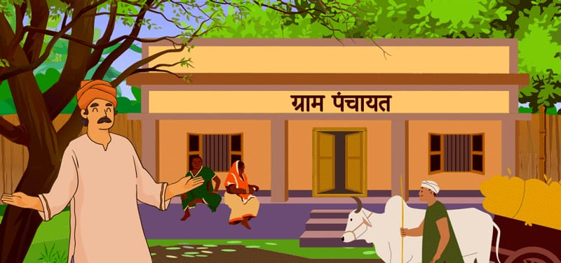

# 🏡 Digital GramPanchayat Portal

A simple web-based **Digital GramPanchayat Portal** concept designed to make common village services easier to access online. The homepage provides entry points for citizen registration, certificate applications, complaint registration, government schemes, and service payments.

## 🖼️ Project Preview

<p align="center">
  
</p>

## ✨ Features

- **Home Page:** Introduces the portal and its e-services.
- **Citizen Registration:** Link to the citizen registration page.
- **Certificate Services:** Option to apply for certificates.
- **Complaint Registration:** Link for submitting complaints.
- **Government Schemes:** Entry point to view scheme information.
- **Service Payment:** Link to the payment page.
- **Navigation Menu:** Links to the portal's main service pages.

> **Note:** The provided `index.html` links to `citizen.html`, `certificate.html`, `complaint.html`, `scheme.html`, and `payment.html`. Add these pages to your repository if you want those links to work.

## 🛠️ Technologies Used

- HTML5
- CSS3

The homepage uses HTML for structure and CSS for styling, including a background image, navigation bar, service cards, buttons, and footer.

## 📁 Suggested Project Structure

```text
Digital-GramPanchayat/
├── index.html
├── css/
│   └── style.css
├── assets/
│   └── grampanchayat.jpeg
├── citizen.html
├── certificate.html
├── complaint.html
├── scheme.html
├── payment.html
└── README.md
```

This is a suggested structure. Include the files that actually exist in your project, and update image paths if you store the image elsewhere.

## 🚀 How to Run

1. Download or clone the repository.
2. Keep `index.html`, the CSS file, and the image in their expected locations.
3. Open `index.html` in a web browser.

No build tools are required for this basic HTML/CSS homepage.

## 🔮 Future Improvements

- Make the website responsive on mobile devices.
- Add form validation for registration and complaints.
- Connect forms to a backend and database.
- Add secure authentication for citizens and administrators.
- Show application status and payment history.
- Add Marathi and other local-language support.
- Improve accessibility and usability.

## 👨‍💻 Author

**Prathamesh Patil**

---

If you find this project useful, consider giving the repository a star ⭐
